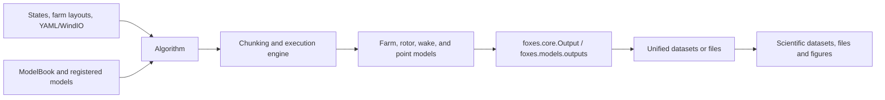

# FOXES Architecture

## Purpose

This document is the durable technical map of FOXES (Farm Optimization and
eXtended yield Evaluation Software). FOXES is a public Python library for
vectorized wind-farm simulation, engineering wake modelling, optimization
support, model comparison, and result evaluation. It is an established package,
not an application scaffold.

Use [naming conventions](naming-conventions.md) for detailed domain vocabulary,
types, dimensions, and identifiers. Use
[docstring conventions](docstrings.md) for public Python documentation and
[development](development.md) for setup, quality gates, test selection,
documentation builds, and navigation. Record the reason for a consequential
change in an [ADR](adr/README.md).

## Authoritative Sources

When sources disagree, use this order:

1. `AGENTS.md` and any applicable scoped repository instructions
2. Accepted ADRs in `docs/adr/`, for decisions within those policies
3. This architecture document and `docs/naming-conventions.md`
4. Public contracts and configuration in `foxes/` and `pyproject.toml`
5. Tests that exercise the contract
6. Examples, notebooks, and external references

Code and tests establish current runtime behavior and can expose documentation
drift, but they do not silently replace a documented durable decision. Resolve
the conflict and update the record in the same change.

## System Context

FOXES serves wind-energy researchers, engineers, and developers. A typical
caller supplies ambient conditions (`States`), a `WindFarm`, and model choices;
an `Algorithm` coordinates model execution through an `Engine`. Chunk-based
output models unify selected farm results into datasets or write files; point
calculations expose xarray datasets.

- Runtime: Python 3.10 through 3.14 on operating-system-independent Python
	environments.
- Core scientific stack: NumPy, pandas, SciPy, xarray, matplotlib, NetCDF4,
	h5netcdf/h5py, PyYAML, tqdm, and utm.
- Optional integrations are isolated behind extras, including `foxes-opt`,
	ERA5/metpy, geospatial shapefiles, MPI, Ray, multiprocess, and Dask.
	The aggregate `engines` extra combines the existing `dask`, `mpi`,
	`multiprocess` and `ray` extras without duplicating package requirements;
	system MPI and scheduler infrastructure remain external prerequisites.
- FOXES is an in-process library and command-line toolkit. It has no application
	server, authentication boundary, database, or browser frontend.
- Parallel execution can be local or distributed. Engine implementations own
	chunking, dispatch, and result collection; scientific models should remain
	backend-independent.

## Primary Execution Flow

1. Construct `States`, usually from `foxes.input.states`.
2. Construct a `WindFarm` and add turbines through layout helpers or directly.
3. Optionally customize a `ModelBook`; otherwise use its registered defaults.
4. Construct `Downwind`, `Iterative`, or `Sequential` with the farm, states, and
	model selections.
5. Call `calc_farm()`, `calc_points()` or `calc_outputs()` with selected outputs.
6. Select farm collection or writing through `ModelBook.outputs` or concrete
	`foxes.models.outputs` instances. Evaluate collected datasets with downstream
	scientific code, or select constructor-defined plotting/table outputs through
	the same algorithm lifecycle. All concrete outputs live in that structure.

YAML parameter files mirror this object graph. The YAML reader constructs the
states, model book, farm, engine, and algorithm, then invokes the same runtime
contracts as Python callers.

All Python example workflows remain in monolithic `main(argv=None)` functions.
`-R/--results` selects calculation outputs, defaulting to `farm_results`;
`-r` remains the rotor shortcut and reference points use `--ref_xy`.
Subsequent `-o/--outputs` models have script-specific defaults: tables, maps,
roses, flow plots, animations or numerical exports. Each receives the
`farm_results` key from the calculation mapping, or `None` when absent.
Independent output calls permit different point grids. Both stages use
`ret_dict=True` and print every returned key followed by its value on a new line.
Sequential retains its iterator and step-local animation plugin; a Downwind
output-only processor collects its accumulated data and runs selected farm
outputs without repeating farm physics.

`examples/run_all.py` executes one explicitly marked README command per example
through Python APIs, in an isolated temporary copy. Its independent `--quick`
and `--nofig` choices bound local inputs and suppress images, respectively.
Python examples skip image-only output grids before calculation, not just
rendering. Explicit numerical point outputs, NetCDF writers and scientific
input reductions still run.
Configuration/UTM state, working directory and plotting state are restored;
temporary files and example-owned figures are removed on success and failure.
Quick ICON/EWW data is synthetic, Slurm runs locally, and public WindIO includes
are inlined before translation, without requiring the optional WindIO loader.
Every example accepts `-v`/`--verbosity`, with `-v` reserved for verbosity and
`--var` for plot-variable selection. The aggregate runner passes `-v 0` by
default, while standalone Python examples default to level-two reports.
Level one selects a concise summary and level three enables library progress.
Levels two and three print all returned results from both stages once, including
non-farm and aggregated values. Comparison and benchmark cases each report
their own mappings; empty mappings do not fabricate farm data. YAML/WindIO
retain their own dataset-reporting behavior and receive the unreduced example
level and reduce scientific component verbosity themselves.
Explicit command verbosity takes precedence over the runner default. Quiet runs
retain contextual errors and
missing-output diagnostics rather than discarding stdout/stderr globally.
Numerical NetCDF outputs inherit algorithm verbosity unless their explicit
write options select another level.
Animation examples pass their script level directly to selected animation outputs:
level one announces creation; two adds file-writing and successful-completion
messages, frame counts and encoder settings; three reports composition and
encoding per frame.
Scientific algorithms and engines retain their separate, reduced library level.

## Module Boundaries

| Module | Owns | Main interfaces and dependencies |
|---|---|---|
| `foxes.config` | Global numeric types, work/input/output paths, NetCDF engine, UTM settings | `config`, `get_path`; standard library and NumPy-facing settings |
| `foxes.core` | Abstract model, algorithm, engine, output, state, farm, turbine, and data-container contracts | `Model`, `DataCalcModel`, `Algorithm`, `Engine`, `Output`, `OutputList`, `States`, `WindFarm`, `MData`, `FData`, `TData` |
| `foxes.models` | Concrete farm, rotor, turbine, wake, ground, point, and adopted output models | `ModelBook`, `foxes.models.outputs`, concrete implementations; depends on core contracts and utilities |
| `foxes.algorithms` | Simulation orchestration and model-chain assembly | `Downwind`, `Iterative`, `Sequential`; depends on core contracts and registered models |
| `foxes.engines` | Serial, process, thread, Dask, MPI, Ray, and related execution backends | `Engine` implementations and runners; optional backend dependencies stay here |
| `foxes.input` | States, farm-layout readers, YAML/WindIO loading, and data-conversion CLIs | Produces core `States`, `WindFarm`, and algorithm inputs |
| `foxes.data` | Discovery and registration of packaged static farm, state, curve, and model data | `StaticData`, `DataBook` entries; package resources and filesystem inputs |
| `foxes.utils` | Shared factories, dictionaries, geometry, interpolation, subclass lookup, and data access | Infrastructure used across modules; avoid domain orchestration here |
| `examples` and `notebooks` | Executable user workflows and documentation examples | Public APIs only wherever practical |
| `tests` | Consistency, verification, model, example, and utility coverage | May inspect internals only when the internal contract itself is under test |

The package root exposes a deliberately small convenience API, including
`WindFarm`, `Turbine`, `Engine`, `ModelBook`, configuration, static data, and the
main subpackages. Subpackage `__init__.py` files own curated exports. Internal
helpers do not become public merely because another module imports them.

## Runtime Contracts

### Dimensions And Variables

`foxes.constants` is the source of structural keys and dimension names; import
it as `FC`. `foxes.variables` is the source of physical field names; import it
as `FV`. Avoid local string copies of established constants.

- Farm data starts with dimensions `(FC.STATE, FC.TURBINE)`.
- Target variables start with `(FC.STATE, FC.TARGET, FC.TPOINT)`.
- Target coordinates use
	`(FC.STATE, FC.TARGET, FC.TPOINT, FC.XYH)`.
- Turbine ground positions have shape `(2,)` for static layouts or
	`(FC.STATE, 2)` for state-dependent layouts. `InitFarmData` materializes both
	as `FV.TXYH` with dimensions `(FC.STATE, FC.TURBINE, FC.XYH)`; spatial bounds
	contain every turbine position over all states.
- Ambient fields use the established `FV.AMB_*` names; do not infer ambientness
	from array location alone.
- Dimension metadata is part of the contract. A numerically correct array with
	the wrong dimension tuple is invalid.

`Model.get_data()` resolves sources in `lookup` order (`"smft"` by default)
and aligns named data-container dimensions to the requested target. Model
attributes follow leading target dimensions. When the source shape differs
from the target shape, `get_data()` returns a read-only NumPy broadcast view;
matching-shape sources retain their existing storage and writeability. Both
`upcast` and `broadcast` options have been removed. NumPy selections operate
on the full target shape, with lists treated as tuples of indices. NaN
validation applies to returned values. Iteration-state reconstruction applies
only to farm/wake-source lookups and uses private writable storage before
enforcing the requested result ownership.

### Data Containers

Collected farm datasets may carry wind-farm and cluster membership coordinates
on the turbine axis. `FData` preserves these static labels when results are
reused for point calculations or output reduction; they are not state/turbine
physical fields. Their declared turbine dimensions still undergo ordinary
shape validation.

- `MData` stores model and chunk metadata.
- `FData` stores farm data and enforces leading state/turbine dimensions.
- `TData` stores targets, target-point weights, and point variables.
- These containers are NumPy-backed mappings with dimension and size metadata;
	they are not xarray datasets.
- Dimensioned data containers expose arrays with their full declared shape.
	When input axes of size one correspond to larger known dimension sizes,
	containers use read-only NumPy broadcast views rather than materializing
	repeated values. Static `FC.TARGETS` therefore have their full logical state
	shape while sharing singleton backing storage; state-dependent targets
	retain their distinct values for each state.
- Output slice grids use static `(n_points, 3)` coordinates. `SliceData` and
	`FlowPlots2D` pass these directly to point calculation without repeating them
	over states. Returned grid-data tuples use the same static representation;
	calculated point-result dimensions and mean weights are unchanged.
- `LoadedData` separates `coords`, dimensioned `data_vars`, and non-array
	`extra_data` during initialization.
- `Downwind.calc_farm()` defaults to an xarray farm dataset. A single output
	with exactly one returned result is unwrapped; multiple outputs return a
	result-name keyed mapping. `ret_dict=True` preserves that mapping for any
	selection in `calc_farm`, `calc_points` and `calc_outputs`, including delegated
	point calculations. Iterative keeps internal convergence datasets unchanged.
	Writer-only or disabled collection returns an
	empty mapping. `calc_points()` collects state/target tiles through
	`PointResultsOutput`, retaining its dataset-facing contract. Point collectors
	and writers select named default/all wind-field sets independently of farm
	variable sets.
- Concrete output models consume NumPy data in workers and construct xarray
	only when collecting a full dataset or writing an individual file.
- Point calculations use target dimensions internally. `calc_points()` selects
	the single target-point axis and renames `FC.TARGET` to the public `FC.POINT`
	dimension before returning its dataset.

### Model Lifecycle

Dataset-backed states preprocess in-memory inputs before applying positional
and label selections. Farm-derived spatial slices, including interpolation
neighbours, therefore restrict prepared model arrays before engines split them
by state. Selection uses local dataset views; a caller-owned full-grid source
can be reused by fresh states for another farm without being cropped in place.
`DatasetStates.crop_to_farm` defaults to enabled. Disabling it retains horizontal
and vertical input support beyond the farm, while explicit `sel`, `isel` and
`height_bounds` remain effective. WindIO disables it for every dataset-backed
resource before initialization. Interpolation policy is unchanged; the larger
support remains subject to normal loading and engine chunking. See
[ADR-0044](adr/0044-explicit-farm-cropping.md).

`SectorManagement` rules identify turbines by their original farm index or
name. Chunk-local evaluation maps those identities through `FV.ORDER` and
honors the controller's state-turbine selection, including iterative passes.
Range conditions use inclusive lower and exclusive upper bounds.

`PowerMask` applies a cubic smoothstep boost transition over `P_lim` power
units below nominal power. Its thrust calculation uses the low-induction
momentum branch, saturating at induction `1/3` and thrust coefficient `8/9`
when requested power exceeds the calibrated Betz maximum. Requested power is
retained: this is an engineering thrust approximation, not an attainable-power
or controller model. See [ADR-0007](adr/0007-smooth-power-mask-boosts.md).

`TurbineEvaluation` computes requested performance fields in `fdata` without
reducing its `(FC.STATE, FC.TURBINE)` axes. Nominal capacity and power-unit
conversion follow the original turbine identity through `FV.ORDER`. Annualized
yield is unweighted power times 8760 hours, converted to GWh/a; apply state
weights only during later aggregation. P75/P90 require explicit relative
uncertainty. See [ADR-0016](adr/0016-state-turbine-performance-evaluation.md).
Efficiency uses an unclipped power ratio with explicit zero handling: zero
numerators give zero (including `0 / 0`), and nonzero numerators over either
signed zero give positive infinity without division warnings. NaNs propagate
otherwise; nominal-capacity validation remains unchanged. This supersedes raw
NumPy zero-division semantics under
[ADR-0025](adr/0025-turbine-evaluation-zero-division.md).
Output preparation evaluates metrics in the incoming calculation order,
before filtering or restoring physical arrays to original farm order through
the inverse of `FV.ORDER`. The order variable itself remains downwind-sequence
metadata. Intermediate Iterative preparation uses `reorder=False`; the final
pass creates preparation with reordering enabled. Tests use three distinct
turbine types, mixed units and non-self-inverse permutations across states.

Output variable selection is the ordinary evaluation entry point.
`PrepareForOutput` applies `TurbineEvaluation` to missing explicitly selected
fields before filtering and restoring original farm order. No manual
turbine-model registration is required. An unrestricted selection retains
available fields without synthesizing additional metrics. Collection and
writing and physical aggregation remain output responsibilities, configured
through collectors and their writer subclasses, not competing evaluators.
Turbine-trace
animation rendering belongs to `_flow_animation_render`, not an evaluator.
See [ADR-0022](adr/0022-output-selected-turbine-evaluation.md).

Downwind adds an evaluation-only controller pass after ambient copying and wake
calculation, before output preparation. This covers unwaked turbines, no-wake
farms and ambient-only metric selections without rerunning power-changing
models. Iterative also evaluates final under-relaxed powers before output,
aligning fresh original-order turbine selections with downwind-ordered results
without mutating the model data. `FarmController.calculate()`
and `FarmDataModelList.calculate()` support `model_names` to retain model order,
parameters and state-turbine selections while executing only named models.

`Model.initialize()` recursively initializes submodels and calls `load_data()`.
Execution is bracketed by `set_running()` and `unset_running()`, which may move
large data through a stash. `finalize()` recursively releases initialized state
and cannot run while the model is marked running.
When running model graphs share submodels, a non-null stash identifies lifecycle
ownership: cleanup leaves running submodels absent from that stash untouched.

For all FOXES models, between `set_running()` and `unset_running()`, instance
state is treated as read-only.
Avoid both attribute assignment and mutation of objects referenced by `self`.
Threads may share model instances; process workers receive separate copies.
Chunk-local working data belongs in `mdata`, `fdata`, `tdata` or local variables, while
run-level aggregation, counters, buffers and futures belong in engine-owned
chunk stores or explicit result mappings. Persistent configuration is prepared
before execution. Necessary lifecycle-managed mutations must account for
ownership, synchronization, worker copies and cleanup.

Do not manually set lifecycle flags, calculate with an uninitialized model, or
hide large persistent arrays outside the loading/stashing contract. A
`DataCalcModel.calculate()` implementation operates on one engine chunk and
returns a mapping of FOXES variable names to NumPy arrays with declared shapes.

### Algorithms And Engines

Algorithms own assembly and ordering of model chains. They prepare data,
delegate chunk execution to an engine, and reconstruct ordered xarray results.
Models must not select a parallel backend or depend on a concrete engine.

Engines own chunk-store detachment and reattachment. After worker cleanup they
reattach the supplied cache even on failure, merging worker updates on success.
Shared-cache mutations are not rolled back. Iterative retains its explicit
full-state cache snapshot restoration after selected-state passes.
Engines also bracket selected outputs with `set_running()` and
`unset_running()`, using the calculation's state selection and a parent-owned
stash. Outputs remain running through result finalization; their configuration
is restored after workers finish, including on failure.
`Engine.run_calculation()` owns this lifecycle and parent-side output
finalization. Backends implement the abstract `_create_calculation()`,
`_run_calculation()` and `_cleanup_calculation()` hooks. Per-call contexts hold
cache updates, output mappings, chunk counts and backend resources; no run state
is retained on the engine. `PoolEngine` handles dispatch and worker cleanup, while
`DefaultEngine` delegates those hooks without nesting the output lifecycle.
`Engine._collect_results()` consumes `iter_results()` in submission order,
merges worker payloads and cache updates, and invokes output updates. Eager
backends yield each result without waiting for the whole batch; synchronous
results are collected before the next chunk executes. Lazy Dask graphs remain
scheduled together and yield results after their bounded batch completes.
Backend progress callbacks run only after each chunk's updates succeed.
The output's initial result mapping is passed through backend delegation and
updated in place during collection, then used for parent-side finalization.
It is created before output stashing, so initialized data can remain parent-owned
without being serialized to workers. `OutputList` combines child mappings while
preserving their values' identity and rejects duplicate initial result keys.
Each output explicitly implements its own initial-result and running hooks.
Rendering and writing options use separate model-private result keys, retaining
original figures, axes and callbacks without recursive copying. The output's
`set_running()` stashes and removes its named attributes; `unset_running()`
restores them. Finalizers consume their own keys and pass concrete options to
renderers without reattaching them while running. `Output` provides no attribute
registry, generic ownership bundle or automatic stashing mechanism.
Only worker-required configuration and scientific selectors remain on workers.
Metadata-only calls use `Engine.run_calculation(model=None)`, exercising the same
initial-result, running and finalization lifecycle without scientific dispatch.
With supplied farm or point datasets, `model=None` dispatches output-only chunks
only when `Output.requires_chunk_calculation` is true (the default). Input
selection precedes initial results in these calls and is not repeated by the
backend. `OutputList` requires chunks if any child does, skipping parent-only
children on output-only workers; scientific runs still calculate every child.
For every calculation, the engine shallow-copies the `extra_data` mapping,
borrowing its payloads without copying arrays or datasets. Previous farm results
added during output processing or scientific iteration remain run-local and
cannot override supplied inputs in subsequent point calculations. Iterative
passes explicitly supply their convergence history to each engine call.
Plain `StateTurbineTable` instances borrow the selected farm dataset through an
explicit private initial-result key and format it directly during finalization.
They preserve input arrays and metadata while applying existing power-unit
normalization. Aggregating tables retain worker reductions, and fresh scientific
chunk results always take precedence over supplied data.
See [ADR-0041](adr/0041-parent-only-supplied-results.md).
The Sequential animation adapter also uses explicit results and normal
finalization. Public results and caller-owned plotting objects retain their
identity. See [ADR-0040](adr/0040-explicit-output-data-lifecycle.md).

`SupportWindRosePlotOutput`, selected as `support_rose_plot`, reads the current
binned states' native histogram through model-data inputs when creating initial
results. It preserves support coordinates, sparse-bin locations, native `WS` and
`WD` edges and percentage weights; it neither interpolates points nor recalculates
farm physics. No histogram is retained on the output instance. Binned states
expose numerical data only; support-rose rendering belongs to output finalization.
The optional `_prepare_calculation_inputs()` helper selects and validates
datasets and moves previous farm results into chunk metadata. Concrete backends
call it after backend selection. It imposes no pool, future or worker contract;
scheduling, batching, transport and progress remain backend responsibilities.
`PoolEngine` requires `new_runner()` to keep worker execution separate from
parent-side pools and clients. The base `Engine` and delegating `DefaultEngine`
do not require or expose this factory; non-pool engines need no runner.
See [ADR-0038](adr/0038-engine-calculation-lifecycle.md).

`Downwind.calc_farm(outputs=...)` accepts an `Output`, a name from
`ModelBook.outputs`, or a list of models and names. Variable selections belong
to `FarmResultsOutput(variables=...)`; ambient/ordinary filtering belongs to
its `ambient_vars` and `waked_vars` flags. `ambient=True` still controls the
scientific calculation, independently of output selection.

`calc_points(outputs=...)` uses the selected point output's `variables`,
`ambient_vars` and `waked_vars` to choose ambient and ordinary result fields;
`ambient=True` controls only the scientific calculation.
Iterative and Sequential use explicit intermediate collectors. Iterative keeps
all convergence fields in downwind order and restores farm order only for final
outputs. Requested output models are initialized and executed only in its final
evaluation pass; a separate internal collector serves the convergence loop.
Streamline geometry is cached in canonical source-coordinate order and selected
back into each caller's turbine order. Forward-streamline ordering extends
end-segment projections to rank turbines outside the sampled path; individual
wake evaluation retains its bounded geometry. Both Downwind and Iterative
therefore preserve source identities across farm calculations and independent
point evaluation. Cache lookups across target chunks retain current-state label
selection; only lookbacks to historical state chunks bypass that alignment.
The `"default"` farm-field set includes thrust coefficients alongside standard
layout, wind and power diagnostics, retaining standard point-calculation inputs.
Point callers needing additional model-specific wake inputs select an explicit
variable list or `"farm_results_all"`.

Use `Engine` as a context manager for an explicit backend. `Engine.new()` maps
established names to implementations. If no engine is active, FOXES creates a
default engine; `DefaultEngine` chooses a single-chunk or process strategy from
the problem size. Engine changes therefore require both numerical-equivalence
tests and coverage of chunk boundaries and cleanup.

Across engine backends, the engine passes ordered worker
payloads to output `update_results()` hooks and calls `finalize_results()` after
all chunks have arrived. Writers await submitted file jobs so worker exceptions
propagate to the caller.

NetCDF writing belongs exclusively to output models. Engines have no file-writing
options or chunk-file helpers; compose a collector with a writer when both files
and an in-memory dataset are required.

`Engine.await_results()` resolves ordered batches. Local Dask schedules complete
batches using a process scheduler by default, rather than computing each chunk
serially. Distributed submissions disable task deduplication for writer side
effects. Shared storage outlives outstanding tasks. Distributed contexts restore
the caller's configuration and release partial startup resources.

Progress is parent-owned: `progress_bar=True` uses adaptive tqdm bars for terminals
and notebooks, with Unicode when supported, and bounded newline-only snapshots
for redirected logs. `False` forces snapshots; `None` or verbosity zero suppresses
progress. Displays use stderr, identify output finalization, and distinguish
failure from completion. Labels use `Engine [model] - status`, without repeated
colon separators. See [ADR-0011](adr/0011-engine-output-execution-and-progress.md).

### Chunk-Based Farm Outputs

All adopted output classes derive from `foxes.core.Output` and live in
`foxes.models.outputs`. `OutputList` merges input-variable requirements and
executes children in declaration order. An empty requirement requests no fields;
`None` requests all available fields.

The public `outputs` argument retains model-book names, output instances and
lists of either. Outputs are fully configured in their constructors; scientific
datasets and algorithms are not constructor inputs or retained instance state.
Point coordinate configuration is materialized in loaded data and stashed off
running models. `get_calc_points(algo)` retrieves static `(n_points, 3)` or state-dependent
`(n_states, n_points, 3)` locations from initialized configuration/loaded data.
`OutputList` rejects disagreeing nonempty point requests instead of silently
choosing a child's grid.

`calc_farm` evaluates requested grids in bounded point slices within each state
chunk. `calc_outputs` uses the ordinary point engine to chunk requested locations,
or collects supplied farm results without rerunning farm physics. Without supplied
results or requested points, outputs requiring farm fields delegate to
`calc_farm`, including unrestricted field requirements. State selections and
return conventions are preserved; the delegated call owns finalization.
Outputs requiring neither farm fields nor points use the metadata-only lifecycle.
Outputs with empty farm-field requirements ignore supplied farm results unless
new point science needs them. Without point inputs or requests, they run only
the metadata lifecycle; empty-field farm collectors return an empty dataset
without borrowing input coordinates. When points are requested without farm
results it first calculates the required farm inputs, even with an empty output
field list. Intermediate farm calculations honor the same state selection as
point execution; state-dependent requested points are selected from the full
algorithm state index in matching label order.
Explicit output farm-field selections are merged with the
`farm_results_default` preset for standard point-calculation inputs, without
mutating either selection. An unrestricted output requirement retains all
available farm fields.
With precomputed point results, only explicit nonempty farm-field requirements
trigger missing farm calculations; unrestricted requirements consume available
fields. No point-calculation baseline is added when point science is skipped.
`calc_points` uses only supplied points or precomputed point results and never
calls `get_calc_points`. Precomputed public point datasets include `FV.X`,
`FV.Y` and `FV.H` coordinates and bypass scientific point calculations.

The promoted consumer family is `FarmLayoutOutput`,
`SliceData`, `SlicesData`, `FlowPlots2D`, `RosePlotOutput`,
`StatesRosePlotOutput`, `WindRoseBinPlot`, `StateTurbineMap`,
`StateTurbineTable`, `PointCalculator`, `RotorPointPlot`,
and `TurbineTypeCurves`. The former output package and root export
are removed. Plane, reduction, fields, binning,
operation and rendering choices are constructor configuration. Data collection
uses private result keys. Workers reduce eliminated dimensions into sufficient
statistics; finalization merges those statistics and handles formatting,
rendering and whole-result writing with explicit run-local data. Private stateless
helpers preserve the established numerical and plotting implementations.

Unaggregated tables, maps, curve plots and single-file writers transport selected
fields, then assemble their required state history once on the parent. Aggregated
tables reuse the farm collector's physical reductions and worker statistics.
Arbitrary-point
means eliminate the state axis on workers, transporting weighted sums and mass;
dynamic coordinates follow the same reduction. Rotor plots need only initialized
rotor metadata and require no scientific fields.
Curve scans are explicit caller-owned algorithms, never hidden calculations or
shared model-book mutations inside outputs. YAML scientific outputs use
constructor definitions and nested result references. The explicit `plt`
exception calls Matplotlib directly in the YAML runner, with no output class.
Stored Matplotlib artists support `object` method calls for shared axes and
figure composition; figure-less runs skip all such calls.
WindIO generates constructor-defined tables and slices, validates positional
state selections, and retains WindIO field/dimension names in numerical files.
Its dataset-backed states disable automatic farm cropping for flow reports and
point calculations beyond the farm horizontally and vertically, retaining
explicit selections and interpolation policy.
Figure suppression propagates through its Python entry point without suppressing
numerical output.
See [ADR-0024](adr/0024-complete-output-adoption.md).

`SliceData` owns numerical slice formatting above a private, non-rendering point
collector. `SlicesData`, `FlowPlots2D` and `FlowAnimation` derive from `SliceData`;
static data and plots never depend on animation settings or validation.
Shared grids, masks and chunk buffers use neutral slice keys. Only mean
reductions require point weights; state-resolved animations still accept
supplied point fields without weights. See
[ADR-0018](adr/0018-slice-first-output-hierarchy.md).

Output payloads contain only fields and axes required by the configured result.
Mean slices return weighted point sums, not state frames or per-state weights;
selected state labels are retained only when explicitly returned. Roses return fixed-size
bin numerators and denominators, with normalization thresholds applied globally.
Layouts return selected turbine geometry and reduced colour values; algorithm
layouts need no scientific payload. Negative positional
selections retain bounded trailing candidates until final selection.
Full-result datasets, file writers and animations retain the state-resolved
fields their results actually require. Static coordinates cross worker boundaries
once per tile and regain full public dimensions during dataset assembly. This
private serialization contract does not change full-shaped data containers.
See [ADR-0019](adr/0019-reduced-output-payloads.md).

`ModelBook.outputs` registers all promoted classes as lightweight presets.
Slice families additionally expose plane/reduction factories with validated
`xy`/`xz`/`yz` and `states`/`mean` choices. State-rose and multi-plane presets
use an explicit 100-metre reference height/normal coordinate; binned roses
default to power with 5 m/s speed bins. Callers configure preset attributes
before initialization or supply their own output instance.

Plotting output constructors default to `show=False`; static model-book plotting
presets and factories enable it, while animation presets/factories keep it
disabled. Display is parent-side and blocking, after any
configured file is saved. Animation objects remain locally referenced while
playing at their configured frame rate; their figures close even on failure.
`plot=False` returns numerical data without display. `Output.nofig=True`
omits image-producing modes before initialization, field preparation and point
requests, returning no image result. Resolution propagates through nested
output chains without mutating their configuration; Sequential animation
plugins apply the same check before step-local point work. Numerical modes,
data-only layout operations and writers remain enabled. Companion probes used
only by script plots declare `image_only=True`. Examples merely configure
`nofig`, rather than filtering output types. See
[ADR-0037](adr/0037-keyed-example-outputs.md).
Numerical outputs and frame generators do not force
display. Caller-selected Matplotlib backends and figure-return schemas are
preserved. Tests keep every output noninteractive, including mocked checks.
See [ADR-0020](adr/0020-output-display-control.md) and
[ADR-0021](adr/0021-noninteractive-animation-and-tests.md).

Model-book registration declarations live in private basics, wake and output
population modules; the public `ModelBook` owns independent registries and lookup.
`Animator` owns generator composition in `foxes.models.outputs.animator`;
flow-animation models delegate parent-local rendering and encoding to
`_flow_animation_render`. Farm and point collectors live in `farm_results` and
`point_results`; all domain writers live in `farm_results_writers` and
`point_results_writers`. There is no generic results-writer class or module.
Both families share physical sufficient-statistic reductions in `_aggregation`,
dimension-aware NumPy
payload operations in `_result_data` and count/calendar policies in
`_result_writers`, while retaining their separate dataset serializers.
Grid geometry, data-format conversion and layout rendering have
focused private helper modules rather than sharing monolithic utility bodies.
Polar rendering for both rose families shares `_rose`; their only numerical
implementation is the chunk-wise `RoseOutput` histogram lifecycle. Superseded
dataset-only reductions are removed rather than kept as test reference helpers.

Output-only runs with supplied farm data bypass Iterative convergence dispatch
and honor their own state selection. They do not reuse cached convergence
arrays or recalculate scientific farm models.

YAML entries for promoted outputs specify class constructors or model-book
presets and execute through `calc_outputs`, without a `functions` list. Presets
are copied before figure flags change; constructor overrides require a class
name or configuration in `model_book.outputs`. Nested `$name` references resolve
before construction; `result_labels` stores the resulting value. `states_sel`
and `states_isel` are mutually exclusive label/position selections applied before
reduction, including for supplied results. Grid consumers retain requested state
ordering as well as limiting execution.
Private `_dict_components` helpers own configuration-time component construction;
the public dictionary runner owns calculation phases and result references.
WindIO turbine tables accept spatial/state aggregation. Flow files stay gridded,
reject point grouping, and accept normalized `aggregate_states`. Both apply
time subsets before reduction and retain external variable/dimension names.
Explicit normalized slice aggregation shares domain sufficient statistics and
directional means; `reduction="mean"` without that flag retains its global
weighted-sum semantics.
Derived fields are selected on the farm collector before calculation, not added
by a post-processing evaluation step. See
[ADR-0017](adr/0017-constructor-defined-output-contract.md).

The implemented farm family is:

- `FarmResultsOutput`: retain ordered chunks and construct one dataset under
	the `FC` result key for its grouping and state reduction, preserving retained
	coordinates and optional names.
- `FarmResultsChunkWriter`: write one file in each state-chunk worker.
- `FarmResultsCountWriter`: buffer ordered chunks and write fixed-size state
	intervals, including multiple files from the final engine chunk.
- `FarmResultsPeriodWriter`: buffer chronological datetime states and write
	calendar days, Monday-based ISO weeks, months or years.

Writers select their own fields. Buffered writers use model-private keys so
they can run before or after a dataset collector without consuming its result.
Without aggregation, farm fields keep state/turbine dimensions during chunk
processing; uniform weights become state-only only at dataset creation.
Writer options and standard path transformations apply to every file. Count
limits must be positive integers; period states must be chronological datetime
values without `NaT`. See [ADR-0010](adr/0010-chunk-based-farm-outputs.md).

The analogous point family is `PointResultsOutput`,
`PointResultsChunkWriter`, `PointResultsCountWriter` and
`PointResultsPeriodWriter`. The engine alone defines state/target chunks;
`calculate()` consumes the supplied `TData`, never generates or rechunks points.
Chunk writers write each tile on its worker, with both engine indices in the
filename. Count/calendar writers assemble complete target slabs in run-local
buffers before applying the shared state-interval policy. Unaggregated files preserve
`(state, target, target_point)` fields and dynamic geometry, including all
target points. Only algorithm-returned point datasets select target point zero
and rename `target` to `point`.

The point model-book family mirrors farm selectors, including ambient/waked
filtering and count/chunk/day/week/month/year writers. Its separate variable
dictionary provides `default` (WS, WD, TI, RHO, their ambient counterparts and
weights) and `all`. `point_results` now uses `default`; choose
`point_results_all` for additional calculated or precomputed fields. See
[ADR-0026](adr/0026-analogous-point-result-outputs.md).
Sequential's internal point collection explicitly retains all calculated fields,
as its internal farm collection does, independently of model-book defaults.

Collectors and all corresponding writers accept independent spatial and state
reductions. `aggregate_turbines=None | "wind_farm" | "cluster" | "all"` groups
original-order farm turbines; `aggregate_points=None | "all"` groups targets.
Farm collectors use `FC.FARM_RESULTS`, `FC.FARMS_RESULTS`,
`FC.CLUSTER_RESULTS` or `FC.TOTAL_FARM_RESULTS` according to turbine grouping;
their `FC.MEAN_*` counterparts indicate state reduction. Point collectors use
`FC.POINT_RESULTS` or `FC.TOTAL_POINT_RESULTS`, and their mean counterparts.
Farm and point totals can be collected together; duplicate keys raise
`ValueError` rather than overwrite results.
See [ADR-0036](adr/0036-domain-total-keys.md).
Missing farm/cluster memberships form an explicit `<unassigned>` group.
Spatial reduction sums power, capacity, maximum power and annualized yields,
averages intensive fields and uses circular means for directions. Turbine
power/capacity/maximum-power fields, including ambient power, are converted to
the smallest power unit used by the farm's initialized turbine types before
any output reduction. Each variable carries one `units` attribute; dataset
attribute `power_unit` records the common power unit. Annualized yields remain
GWh/a. Previously collected fields use their declared unit when processed
again, avoiding repeated native-to-common conversion.

All numerical output datasets and their NetCDF files attach `units` attributes
to known scientific fields and coordinates, including renamed fields, points,
slices, roses, tables and rotor metadata. Ratios and normalized rotor coordinates
use `1`, rose frequencies use `%`, and unknown custom fields receive no invented
unit. Slice quantities divided by non-unit normalization factors use `1`.
Sequential accumulation preserves variable attributes. Private Iterative
convergence history collects native power directly, preserving downwind turbine
identities for the solver and under-relaxation; public outputs remain normalized.
See [ADR-0032](adr/0032-output-dataset-units.md).

`aggregate_states=True` normalizes weights independently for each turbine or
target/target-point position over the selected states. Normalize per entity
before spatial grouping; recompute efficiency and capacity factor from reduced
power and capacity, never from averaged ratios. Zero-weight NaNs are ignored;
negative/nonfinite weights or zero total mass fail explicitly. Raw outputs
retain their supplied weights unchanged.

Workers eliminate state histories into per-entity weighted sums/masses and
sine/cosine sums. Interval writers partition each worker chunk at exact
count/calendar boundaries and transport only those interval statistics.
Parents merge unfinished intervals before normalization and writing; point
tiles retain individual entities until per-entity normalization is possible.
Spatial-only point workers return additive target sums/counts, preserving
uneven-tile weighting. Reductions apply to each output's full selection or each
writer file's own interval/tile. See
[ADR-0027](adr/0027-domain-result-aggregation.md).

### Chunk-Based Flow Animations

`FlowAnimation` replaces engine-owned animation hooks. It uses supplied
`tdata` coordinates and fields when available. Otherwise, initialization loads
one static XY, XZ or YZ point array into `loaded_data["extra_data"]`, eligible for engine
shared storage. Grid bounds include all turbine positions. Farm workers evaluate
the shared points in blocks bounded by the active engine's `chunk_size_points`,
using initialized point models and private copies of farm-ordered chunk inputs.
Its constructor retains configuration only. Validation and preparation run
during initialization, keeping the `ModelBook.outputs` registrations
`"create_gif"` and `"create_mp4"` inexpensive and avoiding unused grids or
scientific submodels. The `"chunk_gif_<chunk>"` and `"chunk_mp4_<chunk>"`
factories select a single state chunk.

`calculate()` returns numerical payloads; `update_results()` buffers only its
private key in the explicit results mapping. `finalize_results()` assembles target
tiles and state chunks in index order and saves one
animation per variable. Rendering is parent-only, never concurrent in worker
threads. Figures are closed on success or failure; write exceptions propagate.
Every animation adds its variable name before the filename extension, including
single-variable selections: `ani.mp4` produces `ani_WS.mp4` for wind speed.
Scientific block limits do not bound final animation memory.
Full state selection is `None`. Partial frame selections are boolean
`(FC.STATE,)` variables in `loaded_data["data_vars"]`, sliced into `mdata` by
engines and applied to chunk payloads. Raw constructor configuration is stashed
while running; neither full selections nor grids/frames remain on the model.

`FlowTurbineAnimation` derives from `FlowAnimation` and adds
selected farm-order state-turbine traces to those same numerical payloads.
Parent-side figure/animator hooks add a synchronized lower panel, optional layout
annotations and a reference marker without duplicating scientific collection,
chunk assembly, encoding or cleanup. The `dyn_wakes` example configures this
class for its local `"create_turbine_gif"` and `"create_turbine_mp4"` registrations; global
flow-only defaults remain unchanged. Global `"create_turbine_gif"` and
`"create_turbine_mp4"` registrations select this two-panel class directly,
using the same `ani.gif` and `ani.mp4` base filenames as the flow-only outputs.
Selecting both variants of the same format requires custom filenames to
retain both files.

Timeline farm runs bootstrap source states before the active chunk with its
first-state turbine values only in iteration zero. Later iterations and final
output evaluation use actual previous-iteration history. Ambient wake geometry
is unchanged; this permits split state chunks without requiring unavailable
history in the initial pass.

`foxes.models.outputs` owns `Animator`, alongside `FlowAnimation` and
`FlowTurbineAnimation`. `foxes.models.seq_plugins` owns all Sequential plugins:
`SeqAnimationOutputPlugin`, `SeqWakeDebugPlugin` and `SeqFlowAnimationPlugin`.
These helpers are not standalone `Output` models.
No aliases preserve the moved helpers' former module paths. See
[ADR-0015](adr/0015-animation-helper-ownership.md).

`SeqAnimationOutputPlugin` bridges these models to Sequential without changing
its physical-field `outputs` argument. It evaluates selected grids through
`algo.calc_points()` during each state step, while wake history is available,
then passes ordered numerical payloads to the shared render hooks at completion.
The plugin, not a running model, owns buffers and optional debug history.
Sequential chunk selections are step indices with target index zero; numerical
point chunks still use the selected engine. See
[ADR-0014](adr/0014-sequential-animation-outputs.md).

`Downwind.calc_points(output=...)` composes an additional output with its standard
point collector before extracting loaded data. Existing dataset returns and
the physical-field selection `outputs=...` are unchanged. Calculation and output
models participate in the complete point-run running/unsetting lifecycle.
Workers retain scientific caches until output calculation has completed.
State-subset cache lookups traverse a shallow snapshot of chunk entries so
concurrent thread workers can insert new chunks without invalidating traversal;
the snapshot does not duplicate scientific arrays.
Static rectangular XY targets reuse flow plotting; irregular/moving targets
retain their actual coordinates in XY scatter frames. GIF/Pillow or MP4/ffmpeg
encoding follows the final filename suffix. See
[ADR-0012](adr/0012-chunk-animation-output.md).

## Extension Points

### Models And Registries

`JensenTurbOParkWake` accepts a model-local `amb_ti` constant (a finite,
strictly positive fraction) as a fallback when wake-source farm data lacks
`FV.AMB_TI`. Farm ambient TI takes precedence. With `ti_var=FV.AMB_TI`, the
same full state-target field feeds `WakeK` before wake selection and the
TurbOPark growth terms after selection. The constant does not populate farm
data for other models.

`ModelBook` owns named `FDict` collections for point models, rotor models,
turbine types and models, farm models and controllers, partial-wake models, wake
frames and deflections, wake superpositions and models, induction models, and
ground models, and outputs.

Model-book factories parse parameterized names such as rotor-grid variants and
cache the resulting model. There is no universal `Model.new()` constructor;
only families that implement subclass discovery support `new()`. Preserve that
distinction between a Python class name, a registered model-book key, and a
parameterized factory name.

Explicit registry entries take precedence over factories. Factories are tried in
registration order; only `ValueError` permits the next factory to be tried.
Register specialized variants before catchalls, keep templates unique, and
advertise only constructor-supported options. The output preset matrix and
model-book reachability tests verify actual construction without lookup caching.

When adding a reusable model:

1. Implement the narrowest suitable core base class and its declared output and
	input-variable contracts.
2. Participate correctly in initialization, running-state, and finalization
	when the model owns data or submodels.
3. Export the public class from the owning package using the established
	explicit re-export style.
4. Register a default instance or factory in `ModelBook` only when name-based
	selection is part of the public feature.
5. Add focused model tests, integration coverage through an algorithm where
	appropriate, API documentation, and an executable example for user-facing
	behavior.

### States, Input, And Static Data

States implementations normalize ambient conditions for algorithms. Input
adapters own parsing and boundary validation; core models should not parse file
formats. `DataBook` and `StaticData` locate packaged or user-supplied data by
logical category. Keep resource lookup separate from scientific calculation.

The WindIO adapter selects the iterative algorithm and per-wake `ground_mirror`
for every enabled blockage (induction wake) model. It also enables ground
mirroring for TurbOPark wind deficits, preserving other per-wake ground settings.
Its unchanged `wake_expansion_coefficient` schema follows WIFA's
`k = k_a * TI + k_b`: `k_a` maps to FOXES `k_1` and `k_b` to `k_0`;
`free_stream_ti` selects `FV.AMB_TI`. Wind deficit coefficients remain the
defaults for turbulence models unless explicitly overridden.

State support-point diagnostics are opt-in loading-time outputs. Regular,
scattered, Weibull, binned, and turbine-backed spatial states expose
`grid_point_plot`; NEWA and meso/micro states use their existing WRF and support
plot hooks. Point-cloud variants share the rendering helper in
`foxes/input/states/point_cloud_data.py`, including cleanup after failed writes.
Separate `*_point_plot_farm_pars` dictionaries customize the farm overlay without
changing support/reference markers or normal visible-turbine/title defaults.
Turbine-backed diagnostics show the current farm layout, not later
state-dependent or optimization coordinates. These plots do not select an
engine or configure global matplotlib state.
Temporary loading layouts label appended reference turbines distinctly; their
default plot uses a contrasting red marker, an empty title, and a legend that
preserves labels from plotted support points.
NEWA WRF support-point plots likewise preserve labeled grid and farm markers
in a legend. CFD grid plots in temporary meso/micro loading layouts crop the
displayed grid to the farm turbines, so distant reference points do not expand
the support-grid domain; the loaded grid and calculation bounds remain
unchanged.
Regular CFD and meso/micro support diagnostics support opt-in per-axis plot
strides, owned by shared point-plot helpers. They preserve grid edges and leave
loaded state data and reference points unchanged. `FarmLayoutOutput` accepts a
figure-only boundary override through `bargs`, so diagnostics from temporary
loading farms can show the original geometry without changing numerical farm
bounds or loading behavior.

`MesoMicroField` owns opt-in loading-time reference calibration smoothing through
`ref_point_radius`. A positive finite radius in metres selects all distinct
available CFD horizontal support points inside each closed reference disk.
Samples use the reference point's height and equal node weights. WS/WD are
converted to U/V before averaging and recovered from the mean vector; other
micro variables use arithmetic means. Smoothed values determine reference
sector directions and speedups, while turbine-target micro fields remain
pointwise. Temporary loading bounds include the disks. Empty disks raise a
contextual error; NaN checks and automatic reference filtering still apply.
`None` retains exact-point calibration. See
[ADR-0006](adr/0006-micro-reference-disk-averages.md).

`MesoMicroField` and `SectorSimRefPointField` store a `wd_bin_map` alongside
sorted local direction bins. It maps each bin back to its original micro/field
state; MEMI stores a separate mapping per reference point. Reference scaling
uses sorted calibration data, while target evaluation uses the mapped original
states. Sector blending and spatial mixing remain normalized independently of
state probabilities. Numeric micro-state coordinates come from the preserved
micro-state axis, never from the active meso-state chunk.
Recompute populations, fitted wake parameters, and final
results produced with misaligned sectors before using them for evaluation.

### Sequential Plugins

Sequential extensions implement the plugin lifecycle (`initialize`, `update`,
`finalize`) and observe algorithm state without taking ownership of engine
execution. Output plugins remain in the output boundary.

## Data And Integration Boundaries

FOXES does not own a persistent database. It reads caller-provided Python
objects and scientific files, holds calculation state in memory, and writes
results only through explicit output APIs or command-line tools.

- Validate external files, YAML values, dimensions, and model names at their
	input boundary. Do not defer a parse error until a worker calculation.
- Optional integration imports must remain optional. Importing base `foxes`
	must not require an extra that the caller did not install.
- Code executed in process or distributed workers must be importable and
	serializable for the selected backend. Runtime classes referenced by worker
	code cannot exist only behind `TYPE_CHECKING` imports.
- Fail with contextual exceptions that identify the model, variable, dimensions,
	or backend involved. FOXES is a library, so do not terminate the interpreter
	for a recoverable caller error.
- Point-cloud support-hull failures name the configured interpolation method and
	the nearest-neighbor fallback setting that can resolve unsupported targets.
- User input data can carry any classification. Before an AI tool inspects such
	data, apply the [data classification policy](data-classification.md).
	Synthetic tests and public packaged examples do not authorize access to a
	user's separate data set.
- No data-classification exception is currently recorded; see
	[data-classification-exceptions.md](data-classification-exceptions.md).

## Performance And Parallelism

Vectorization over states, turbines, targets, and target points is a primary
architectural property. Prefer array operations that preserve the data contract
over Python loops on those axes. At the same time, do not materialize a full
state/target product merely to slice it per engine chunk.

- Let engines choose and propagate chunk metadata.
- Preserve compact backing storage for repeated values with full-shaped
	broadcast views; copy explicitly before writing to such arrays.
- Mean slice workers return state-weighted sums per point tile. Farm-run point
	calculations remain bounded by the selected point chunk size; raw state frames
	are temporary worker inputs, not parent-side mean buffers. Numerical slices
	collect only configured fields. Flow plots add vector fields for quivers and
	farm geometry for rotor overlays only when requested.
- Dataset-backed states reconstruct interpolated point and height ordering with
	paired state/point index gathers, without a field-state/target-state
	cross-product. This includes fixed locations permuted by downwind order.
	`MesoMicroField` likewise gathers only the selected micro-bin/point pairs
	before reference scaling. Upstream dataset-backed spatial interpolation
	still evaluates all input states at all unique coordinates; genuinely moving
	targets and distinct vectorized population layouts can therefore increase its
	intermediate memory footprint. Paired gathers retain population-major state
	ordering, including state chunks that cross population-member boundaries.
- Keep chunk-local results deterministic and independent of task completion
	order.
- Avoid sending unnecessary algorithm state or large caches to every process.
- Preserve state and turbine ordering when collecting parallel results.
- Reduced iterative passes keep farm data in downwind order and reorder fresh
	model data by `FV.ORDER` before evaluating turbine models and controllers.
- Compare serial and parallel numerical results when changing engine-facing
	code; speed alone is not correctness.
- Measure representative state, turbine, and target sizes before accepting a
	memory or runtime optimization.

## Public Interfaces

Public contracts include exported Python classes and functions, model-book
names, dimension and variable constants, YAML/WindIO schemas, packaged data
names, xarray result structure, and the console scripts declared in
`pyproject.toml`. Treat changes to any of these as compatibility-sensitive.

Compatibility-sensitive means identifying the complete impact and moving all
maintained callers, tests, examples, and documentation to the new contract in
one change. It does not imply retaining a legacy path; FOXES development is
forward-only by default under
[ADR-0001](adr/0001-forward-only-development.md).

The command-line entry points currently cover YAML and WindIO execution,
mean-state data creation, WRF/ERA5/ICON conversion, EWW farm conversion, and
Gaussian lookup generation. Keep argument parsing in the input or utility
boundary and reusable logic in importable functions so tests need not spawn a
subprocess.

## Cross-Cutting Decisions

- The farm `"default"` variable set covers standard diagnostics and scientific
  point inputs, including `FV.CT`; the separate `"calc"` set is removed.
  Output-requested point calculations merge this default with explicit farm-field
  requirements and retain unrestricted selections. See
  [ADR-0043](adr/0043-default-farm-variable-set.md).

- Wake growth uses dimensionless `FV.K_0 = "k0"` and `FV.K_1 = "k1"` for
  `k = k_0 + k_1 * TI`. `WakeK` owns direct wake configuration; the `kTI`
  turbine model computes the same relation from uniform values or farm fields.
  Model-book coefficient labels are `k0`/`k1` or `ambk0`/`ambk1`, separated
  from values by underscores. Removed inputs fail with migration guidance;
  no old coefficient values are accepted. See
  [ADR-0042](adr/0042-wake-growth-coefficients.md).

- Outputs declare whether supplied results need chunks through
  `requires_chunk_calculation`. Plain state/turbine tables finalize directly
  from borrowed datasets; aggregation and fresh science remain chunk-based.
  Mixed lists skip parent-only children on output-only workers. See
  [ADR-0041](adr/0041-parent-only-supplied-results.md).

- Figure-producing outputs keep rendering options and caller-owned Matplotlib
  objects in initial result mappings, not running worker models, and restore
  constructor attributes through explicit per-output lifecycle hooks. There is
  no shared attribute registry or ownership bundle. Metadata-only output calls
  use the same engine-owned running lifecycle. See
  [ADR-0040](adr/0040-explicit-output-data-lifecycle.md).

- Calculation entry points offer opt-in keyed returns with `ret_dict=True`.
  Monolithic examples separate `-R/--results` from subsequent `-o/--outputs`;
  `-nf` omits image-only scientific work while retaining numerical outputs.
  See [ADR-0037](adr/0037-keyed-example-outputs.md).

- Collector result keys are fixed by domain, spatial grouping and state
  reduction. Farm and point totals have distinct keys; duplicates are rejected.
  See [ADR-0036](adr/0036-domain-total-keys.md).

- Development closure includes an explicit coding-style review of changed code,
  separate from automated linting and formatting, with its result in the
  completion report. See
  [ADR-0033](adr/0033-coding-style-closure-review.md).

- Numerical outputs carry per-variable unit metadata. Power fields use the
  smallest turbine-type power unit before reduction, without splitting groups;
  internal Iterative history stays solver-native. See
  [ADR-0032](adr/0032-output-dataset-units.md).

- Point collection and writers mirror farm outputs, with independent default/all
  wind-field selections and engine-owned target chunking. Files preserve all
  target points; both families share count/calendar policies. See
  [ADR-0026](adr/0026-analogous-point-result-outputs.md).

- Examples run once each in-process with independent quick/headless choices;
  monolithic tutorial mains are a documented size exception. See
  [ADR-0023](adr/0023-in-process-example-runs.md).

- Animation composition lives in `foxes.models.outputs`; Sequential plugins
  live in `foxes.models.seq_plugins`. See
  [ADR-0015](adr/0015-animation-helper-ownership.md).

- Development is strictly forward-looking by default. Superseded code and
	contracts are removed rather than kept behind compatibility shims; a bounded
	legacy exception requires explicit authorization and a recorded removal
	condition. See [ADR-0001](adr/0001-forward-only-development.md).
- Code changes require focused and full tests. Every change requires full
	pre-commit, affected public docstrings, the current-version final
	`CHANGELOG.md` section, and synchronized FOXES documentation as one completion
	gate, not follow-up work. See
	[ADR-0001](adr/0001-forward-only-development.md).
- `pyproject.toml` is the source of package metadata, supported Python versions,
	dependencies, extras, build configuration, console scripts, and mypy settings.
- Runtime and extra dependency floors exclude the known vulnerable releases
	listed in [development](development.md#security-floors). Dask and Distributed
	share a >=2026.1.0 floor; this does not certify transitive or native libraries.
- Production Python is type checked; tests, examples, notebooks, and docs are
	not currently part of the mypy target.
- Pytest repository-file inputs are limited to `foxes/`, `examples/`,
	`notebooks/`, and `tests/`; temporary test outputs remain allowed.
	Documentation, release metadata, and CI configuration are checked outside
	pytest. See [ADR-0009](adr/0009-test-file-dependency-boundary.md).
- Public Python APIs follow [docstring conventions](docstrings.md): NumPy-style
	docstrings expose the scientific and runtime contract while type information
	remains in annotations.
- Adopted outputs use the core chunk lifecycle and live in
	`foxes.models.outputs`; farm files use explicit count limits or calendar
	periods, including ISO week years. See
	[ADR-0010](adr/0010-chunk-based-farm-outputs.md).
- Constructor-defined outputs execute through algorithm entry points; loaded
	grids and run-local data remain outside model instances. The public `outputs`
	name/string/list selector is unchanged. See
	[ADR-0017](adr/0017-constructor-defined-output-contract.md).
- All concrete outputs are adopted; arbitrary-point means reduce on workers and
	curve scans remain explicit. YAML-only `plt`/Matplotlib artist calls are the
	sole non-model exception. See
	[ADR-0024](adr/0024-complete-output-adoption.md).
- Slice data owns numerical point/grid collection independently of rendering;
	flow plots and animations specialize `SliceData`, using neutral slice keys.
	See [ADR-0018](adr/0018-slice-first-output-hierarchy.md).
- Output workers eliminate dimensions not required by the final result and
	return mergeable sufficient statistics instead of full state frames. Private
	coordinate payloads may be compact while data containers/public datasets keep
	their declared dimensions. See
	[ADR-0019](adr/0019-reduced-output-payloads.md).
- Plotting constructors default to no display; model-book plotting selectors
	enable blocking parent-side display after saving, with run-local ownership.
	Animation presets retain `show=False`, and tests never enable display,
	including mocked checks. See
	[ADR-0020](adr/0020-output-display-control.md) and
	[ADR-0021](adr/0021-noninteractive-animation-and-tests.md).
- Engine output execution uses ordered batches and parent-owned adaptive progress;
	point collection and iterative callers use the same output lifecycle. Corporate
	design remains confirmed for progress displays. See
	[ADR-0011](adr/0011-engine-output-execution-and-progress.md).
- Flow animation is an optional output with shared grid loading, bounded point
	evaluation, target-data reuse and finalization-only file creation. See
	[ADR-0012](adr/0012-chunk-animation-output.md).
- Sequential animation selection uses an iterator plugin with step-local point
	evaluation and shared output-model rendering, not replayed final farm results.
	See [ADR-0014](adr/0014-sequential-animation-outputs.md).
- [AGENTS.md](../AGENTS.md) keeps critical contributor guardrails and routes
	detailed requirements to their owning guides. Code style is detailed in
	[development](development.md#code-quality), lifecycle and parallelization in
	this document, vocabulary in [naming conventions](naming-conventions.md),
	and public Python documentation in [docstrings](docstrings.md).
- Power-mask boosts use a smooth near-rated transition and bounded
	low-induction thrust while preserving requested power. See
	[ADR-0007](adr/0007-smooth-power-mask-boosts.md).
- Dimensioned container arrays and mismatched `Model.get_data()` results use
	full-shaped broadcast views. See
	[ADR-0013](adr/0013-full-shaped-broadcast-data.md).
- Turbine performance metrics retain state-turbine dimensions; annualized
	yield is unweighted and P75/P90 use explicit relative uncertainty. A final
	evaluation-only pass resolves metrics after ambient and wake powers exist.
	See [ADR-0016](adr/0016-state-turbine-performance-evaluation.md).
- Output-selected turbine evaluation is the sole built-in performance
	implementation. Unrestricted collectors retain available fields; aggregate
	farm/cluster evaluators, output helpers and model-book entries are removed.
	See [ADR-0022](adr/0022-output-selected-turbine-evaluation.md).
- Physical result aggregation belongs to domain collectors and their writer
	subclasses, with independent `aggregate_turbines`/`aggregate_points` and
	`aggregate_states` controls, per-entity weight normalization and worker-side
	sufficient statistics. See [ADR-0027](adr/0027-domain-result-aggregation.md).
- All result presets combine named fields, ambient/waked filters, grouping,
	state means and writer policies. Dataset provenance retains only scalar
	pre-reduction counts for eliminated axes. YAML presets and WindIO reports
	use the same reductions; flow files retain grids. See
	[ADR-0028](adr/0028-aggregation-presets-and-provenance.md).
- Named farm/cluster aggregation presets use the implicit `farms_results` and
	`cluster_results` families across collectors and all writer policies.
	Constructor parameters and dataset keys remain unchanged; superseded
	selectors have no aliases. See
	[ADR-0029](adr/0029-grouped-output-preset-families.md).
- All-turbine model-book aggregation uses the implicit `total_results` family
	across filters, named fields, state means and writer policies. Constructor
	options and dataset keys remain unchanged. See
	[ADR-0031](adr/0031-total-output-preset-family.md).
- Output slice grids have no state axis and use the existing static-point
	calculation contract. See
	[ADR-0005](adr/0005-static-output-grid-coordinates.md).
- Ruff formatting/linting and mypy run through pre-commit. Pytest is the test
	runner; Sphinx with AutoAPI, Napoleon, and MyST-NB builds the documentation.
- Dataset-backed states expose `crop_to_farm` for automatic spatial cropping.
	WindIO disables it to retain source support for requested flow grids; explicit
	selections and interpolation policy remain unchanged. See
	[ADR-0044](adr/0044-explicit-farm-cropping.md).
- FOXES scientific plots, animations, notebooks and other visual assets use
	free design under [ADR-0030](adr/0030-free-design.md). Sphinx documentation
	follows the [Fraunhofer IWES UI guide](fraunhofer-design/ui-guidelines.md),
	with authoritative design tokens adapted by `docs/source/_static/iwes-tokens.css`
	and theme overrides in `docs/source/_static/iwes.css`. The custom `iwes`
	palette gives the header its primary green with black text and controls.
	Its complete light/dark and accent mappings also cover the mobile repository
	panel, search states, API badges, code highlighting and typed notices;
	approved steel blue is reserved for informational text and controls.
	Version notices use a single tinted title without a second colored container.
	Added versions use green; changed versions use informational steel blue,
	with matching icons and explicit text labels.
	Existing font sizes must not decrease, including the theme's responsive
	enlargement on wide screens; second-level headings retain at least 25px.
	Local Sphinx previews do not execute notebooks. GitHub Pages builds
	explicitly enable automatic notebook execution to publish their outputs
	without committing generated results to the source notebooks.
	Embedded scientific figures retain free design. See
	[ADR-0045](adr/0045-corporate-documentation-design.md) and the
	[visualization instructions](../.github/instructions/visualization.instructions.md).
	External publication of free-design assets still requires a design and
	accessibility review and may require extensive restyling.

## ADR Triggers

Create or supersede an ADR when a change alters a core data shape, lifecycle,
public result contract, model-registration scheme, engine execution model,
supported runtime range, dependency strategy, module ownership, external
integration, data boundary, UI design policy, or naming rule used across the
package. Local model implementation details that preserve these contracts do
not need an ADR.
