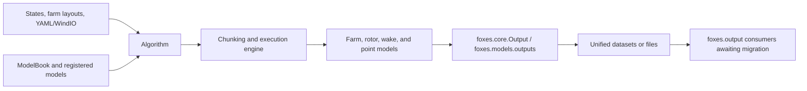

# FOXES Architecture

## Purpose

This document is the durable technical map of FOXES (Farm Optimization and
eXtended yield Evaluation Software). FOXES is a public Python library for
vectorized wind-farm simulation, engineering wake modelling, optimization
support, model comparison, and result evaluation. It is an established package,
not an application scaffold.

Use [naming conventions](naming-conventions.md) for detailed domain vocabulary,
types, dimensions, and identifiers. Use
[docstring conventions](docstrings.md) for public Python documentation and
[development](development.md) for setup, quality gates, test selection,
documentation builds, and navigation. Record the reason for a consequential
change in an [ADR](adr/README.md).

## Authoritative Sources

When sources disagree, use this order:

1. `AGENTS.md` and any applicable scoped repository instructions
2. Accepted ADRs in `docs/adr/`, for decisions within those policies
3. This architecture document and `docs/naming-conventions.md`
4. Public contracts and configuration in `foxes/` and `pyproject.toml`
5. Tests that exercise the contract
6. Examples, notebooks, and external references

Code and tests establish current runtime behavior and can expose documentation
drift, but they do not silently replace a documented durable decision. Resolve
the conflict and update the record in the same change.

## System Context

FOXES serves wind-energy researchers, engineers, and developers. A typical
caller supplies ambient conditions (`States`), a `WindFarm`, and model choices;
an `Algorithm` coordinates model execution through an `Engine`. Chunk-based
output models unify selected farm results into datasets or write files; point
calculations expose xarray datasets.

- Runtime: Python 3.10 through 3.14 on operating-system-independent Python
	environments.
- Core scientific stack: NumPy, pandas, SciPy, xarray, matplotlib, NetCDF4,
	h5netcdf/h5py, PyYAML, tqdm, and utm.
- Optional integrations are isolated behind extras, including `foxes-opt`,
	ERA5/metpy, geospatial shapefiles, MPI, Ray, multiprocess, and Dask.
	The aggregate `engines` extra combines the existing `dask`, `mpi`,
	`multiprocess` and `ray` extras without duplicating package requirements;
	system MPI and scheduler infrastructure remain external prerequisites.
- FOXES is an in-process library and command-line toolkit. It has no application
	server, authentication boundary, database, or browser frontend.
- Parallel execution can be local or distributed. Engine implementations own
	chunking, dispatch, and result collection; scientific models should remain
	backend-independent.

## Primary Execution Flow

1. Construct `States`, usually from `foxes.input.states`.
2. Construct a `WindFarm` and add turbines through layout helpers or directly.
3. Optionally customize a `ModelBook`; otherwise use its registered defaults.
4. Construct `Downwind`, `Iterative`, or `Sequential` with the farm, states, and
	model selections.
5. Call `calc_farm()` and optionally `calc_points()`.
6. Select farm collection or writing through `ModelBook.outputs` or concrete
	`foxes.models.outputs` instances. Evaluate collected datasets with downstream
	scientific code. Existing `foxes.output` consumers await adoption into the
	new output structure; they are not new chunk-output implementations.

YAML parameter files mirror this object graph. The YAML reader constructs the
states, model book, farm, engine, and algorithm, then invokes the same runtime
contracts as Python callers.

Downwind/Iterative Python example scripts expose output model-book selection as
`-o/--outputs`, defaulting to `farm_results`. They accept direct dataset and
composed mapping returns, and skip dataset consumers for writer-only selections
after completing every requested farm run. This example CLI does not change
Sequential's iterator API, YAML configuration or the wake-field exporter.
The Sequential example scripts also expose `-o`, limited to `farm_results` and
flow-animation models through their iterator adapter.

## Module Boundaries

| Module | Owns | Main interfaces and dependencies |
|---|---|---|
| `foxes.config` | Global numeric types, work/input/output paths, NetCDF engine, UTM settings | `config`, `get_path`; standard library and NumPy-facing settings |
| `foxes.core` | Abstract model, algorithm, engine, output, state, farm, turbine, and data-container contracts | `Model`, `DataCalcModel`, `Algorithm`, `Engine`, `Output`, `OutputList`, `States`, `WindFarm`, `MData`, `FData`, `TData` |
| `foxes.models` | Concrete farm, rotor, turbine, wake, ground, point, and adopted output models | `ModelBook`, `foxes.models.outputs`, concrete implementations; depends on core contracts and utilities |
| `foxes.algorithms` | Simulation orchestration and model-chain assembly | `Downwind`, `Iterative`, `Sequential`; depends on core contracts and registered models |
| `foxes.engines` | Serial, process, thread, Dask, MPI, Ray, and related execution backends | `Engine` implementations and runners; optional backend dependencies stay here |
| `foxes.input` | States, farm-layout readers, YAML/WindIO loading, and data-conversion CLIs | Produces core `States`, `WindFarm`, and algorithm inputs |
| `foxes.output` | Existing evaluation, plotting, animation, writing and sequential consumers awaiting adoption | Not the destination for new adopted classes; migration remains incomplete |
| `foxes.data` | Discovery and registration of packaged static farm, state, curve, and model data | `StaticData`, `DataBook` entries; package resources and filesystem inputs |
| `foxes.utils` | Shared factories, dictionaries, geometry, interpolation, subclass lookup, and data access | Infrastructure used across modules; avoid domain orchestration here |
| `examples` and `notebooks` | Executable user workflows and documentation examples | Public APIs only wherever practical |
| `tests` | Consistency, verification, model, example, and utility coverage | May inspect internals only when the internal contract itself is under test |

The package root exposes a deliberately small convenience API, including
`WindFarm`, `Turbine`, `Engine`, `ModelBook`, configuration, static data, and the
main subpackages. Subpackage `__init__.py` files own curated exports. Internal
helpers do not become public merely because another module imports them.

## Runtime Contracts

### Dimensions And Variables

`foxes.constants` is the source of structural keys and dimension names; import
it as `FC`. `foxes.variables` is the source of physical field names; import it
as `FV`. Avoid local string copies of established constants.

- Farm data starts with dimensions `(FC.STATE, FC.TURBINE)`.
- Target variables start with `(FC.STATE, FC.TARGET, FC.TPOINT)`.
- Target coordinates use
	`(FC.STATE, FC.TARGET, FC.TPOINT, FC.XYH)`.
- Turbine ground positions have shape `(2,)` for static layouts or
	`(FC.STATE, 2)` for state-dependent layouts. `InitFarmData` materializes both
	as `FV.TXYH` with dimensions `(FC.STATE, FC.TURBINE, FC.XYH)`; spatial bounds
	contain every turbine position over all states.
- Ambient fields use the established `FV.AMB_*` names; do not infer ambientness
	from array location alone.
- Dimension metadata is part of the contract. A numerically correct array with
	the wrong dimension tuple is invalid.

`Model.get_data()` resolves sources in `lookup` order (`"smft"` by default)
and aligns named data-container dimensions to the requested target. Model
attributes follow leading target dimensions. When the source shape differs
from the target shape, `get_data()` returns a read-only NumPy broadcast view;
matching-shape sources retain their existing storage and writeability. Both
`upcast` and `broadcast` options have been removed. NumPy selections operate
on the full target shape, with lists treated as tuples of indices. NaN
validation applies to returned values. Iteration-state reconstruction applies
only to farm/wake-source lookups and uses private writable storage before
enforcing the requested result ownership.

### Data Containers

- `MData` stores model and chunk metadata.
- `FData` stores farm data and enforces leading state/turbine dimensions.
- `TData` stores targets, target-point weights, and point variables.
- These containers are NumPy-backed mappings with dimension and size metadata;
	they are not xarray datasets.
- Dimensioned data containers expose arrays with their full declared shape.
	When input axes of size one correspond to larger known dimension sizes,
	containers use read-only NumPy broadcast views rather than materializing
	repeated values. Static `FC.TARGETS` therefore have their full logical state
	shape while sharing singleton backing storage; state-dependent targets
	retain their distinct values for each state.
- Output slice grids use static `(n_points, 3)` coordinates. `SliceData` and
	`FlowPlots2D` pass these directly to point calculation without repeating them
	over states. Returned grid-data tuples use the same static representation;
	calculated point-result dimensions and mean weights are unchanged.
- `LoadedData` separates `coords`, dimensioned `data_vars`, and non-array
	`extra_data` during initialization.
- `Downwind.calc_farm()` defaults to an xarray farm dataset. A single output
	with exactly one returned result is unwrapped; multiple outputs return a
	result-name keyed mapping. Writer-only or disabled collection returns an
	empty mapping. `calc_points()` collects state/target tiles through
	`PointResultsOutput`, retaining its dataset-facing contract.
- Concrete output models consume NumPy data in workers and construct xarray
	only when collecting a full dataset or writing an individual file.
- Point calculations use target dimensions internally. `calc_points()` selects
	the single target-point axis and renames `FC.TARGET` to the public `FC.POINT`
	dimension before returning its dataset.

### Model Lifecycle

`SectorManagement` rules identify turbines by their original farm index or
name. Chunk-local evaluation maps those identities through `FV.ORDER` and
honors the controller's state-turbine selection, including iterative passes.
Range conditions use inclusive lower and exclusive upper bounds.

`PowerMask` applies a cubic smoothstep boost transition over `P_lim` power
units below nominal power. Its thrust calculation uses the low-induction
momentum branch, saturating at induction `1/3` and thrust coefficient `8/9`
when requested power exceeds the calibrated Betz maximum. Requested power is
retained: this is an engineering thrust approximation, not an attainable-power
or controller model. See [ADR-0007](adr/0007-smooth-power-mask-boosts.md).

`TurbineEvaluation` computes requested performance fields in `fdata` without
reducing its `(FC.STATE, FC.TURBINE)` axes. Nominal capacity and power-unit
conversion follow the original turbine identity through `FV.ORDER`. Annualized
yield is unweighted power times 8760 hours, converted to GWh/a; apply state
weights only during later aggregation. P75/P90 require explicit relative
uncertainty. See [ADR-0016](adr/0016-state-turbine-performance-evaluation.md).

Downwind adds an evaluation-only controller pass after ambient copying and wake
calculation, before output preparation. This covers unwaked turbines, no-wake
farms and ambient-only metric selections without rerunning power-changing
models. Iterative also evaluates final under-relaxed powers before output,
aligning fresh original-order turbine selections with downwind-ordered results
without mutating the model data. `FarmController.calculate()`
and `FarmDataModelList.calculate()` support `model_names` to retain model order,
parameters and state-turbine selections while executing only named models.

`Model.initialize()` recursively initializes submodels and calls `load_data()`.
Execution is bracketed by `set_running()` and `unset_running()`, which may move
large data through a stash. `finalize()` recursively releases initialized state
and cannot run while the model is marked running.

For all FOXES models, between `set_running()` and `unset_running()`, instance
state is treated as read-only.
Avoid both attribute assignment and mutation of objects referenced by `self`.
Threads may share model instances; process workers receive separate copies.
Chunk-local working data belongs in `mdata`, `fdata`, `tdata` or local variables, while
run-level aggregation, counters, buffers and futures belong in engine-owned
chunk stores or explicit result mappings. Persistent configuration is prepared
before execution. Necessary lifecycle-managed mutations must account for
ownership, synchronization, worker copies and cleanup.

Do not manually set lifecycle flags, calculate with an uninitialized model, or
hide large persistent arrays outside the loading/stashing contract. A
`DataCalcModel.calculate()` implementation operates on one engine chunk and
returns a mapping of FOXES variable names to NumPy arrays with declared shapes.

### Algorithms And Engines

Algorithms own assembly and ordering of model chains. They prepare data,
delegate chunk execution to an engine, and reconstruct ordered xarray results.
Models must not select a parallel backend or depend on a concrete engine.

`Downwind.calc_farm(outputs=...)` accepts an `Output`, a name from
`ModelBook.outputs`, or a list of models and names. Variable selections belong
to `FarmResultsOutput(variables=...)`; ambient/ordinary filtering belongs to
its `ambient_vars` and `waked_vars` flags. `ambient=True` still controls the
scientific calculation, independently of output selection.

`calc_points()` retains `ambient_keep=False` for its point-facing contract.
Iterative and Sequential use explicit intermediate collectors. Iterative keeps
all convergence fields in downwind order and restores farm order only for final
outputs. Requested output models are initialized and executed only in its final
evaluation pass; a separate internal collector serves the convergence loop.
Streamline cases use the Iterative algorithm.
The `"default"` field set is unchanged; point callers needing all wake
inputs select `"farm_results_all"` explicitly.

Use `Engine` as a context manager for an explicit backend. `Engine.new()` maps
established names to implementations. If no engine is active, FOXES creates a
default engine; `DefaultEngine` chooses a single-chunk or process strategy from
the problem size. Engine changes therefore require both numerical-equivalence
tests and coverage of chunk boundaries and cleanup.

Across engine backends, the engine passes ordered worker
payloads to output `update_results()` hooks and calls `finalize_results()` after
all chunks have arrived. Writers await submitted file jobs so worker exceptions
propagate to the caller.

NetCDF writing belongs exclusively to output models. Engines have no file-writing
options or chunk-file helpers; compose a collector with a writer when both files
and an in-memory dataset are required.

`Engine.await_results()` resolves ordered batches. Local Dask schedules complete
batches using a process scheduler by default, rather than computing each chunk
serially. Distributed submissions disable task deduplication for writer side
effects. Shared storage outlives outstanding tasks. Distributed contexts restore
the caller's configuration and release partial startup resources.

Progress is parent-owned: `progress_bar=True` uses adaptive tqdm bars for terminals
and notebooks, with Unicode when supported, and bounded newline-only snapshots
for redirected logs. `False` forces snapshots; `None` or verbosity zero suppresses
progress. Displays use stderr, identify output finalization, and distinguish
failure from completion. Labels use `Engine [model] - status`, without repeated
colon separators. See [ADR-0011](adr/0011-engine-output-execution-and-progress.md).

### Chunk-Based Farm Outputs

All adopted output classes derive from `foxes.core.Output` and live in
`foxes.models.outputs`. `OutputList` merges input-variable requirements and
executes children in declaration order. An empty requirement requests no fields;
`None` requests all available fields.

The implemented farm family is:

- `FarmResultsOutput`: retain ordered chunks and construct one dataset under
	`FC.FARM_RESULTS`, preserving state/turbine coordinates and optional names.
- `FarmResultsChunkWriter`: write one file in each state-chunk worker.
- `FarmResultsCountWriter`: buffer ordered chunks and write fixed-size state
	intervals, including multiple files from the final engine chunk.
- `FarmResultsPeriodWriter`: buffer chronological datetime states and write
	calendar days, Monday-based ISO weeks, months or years.

Writers select their own fields. Buffered writers use model-private keys so
they can run before or after a dataset collector without consuming its result.
Farm field arrays keep state/turbine dimensions during chunk processing;
uniform weights are reduced to state-only dimensions only at dataset creation.
Writer options and standard path transformations apply to every file. Count
limits must be positive integers; period states must be chronological datetime
values without `NaT`. See [ADR-0010](adr/0010-chunk-based-farm-outputs.md).

`normalize=True` normalizes the collected weighted farm dataset after output
finalization. It does not rewrite files or renormalize each file independently.

### Chunk-Based Flow Animations

`FlowAnimation` replaces engine-owned animation hooks. It uses supplied
`tdata` coordinates and fields when available. Otherwise, initialization loads
one static XY point array into `loaded_data["extra_data"]`, eligible for engine
shared storage. Grid bounds include all turbine positions. Farm workers evaluate
the shared points in blocks bounded by the active engine's `chunk_size_points`,
using initialized point models and private copies of farm-ordered chunk inputs.
Its constructor retains configuration only. Validation and preparation run
during initialization, keeping the `ModelBook.outputs` registrations
`"create_gif"` and `"create_mp4"` inexpensive and avoiding unused grids or
scientific submodels. The `"chunk_gif_<chunk>"` and `"chunk_mp4_<chunk>"`
factories select a single state chunk.

`calculate()` returns numerical payloads; `update_results()` buffers only its
private key in the explicit results mapping. `finalize_results()` assembles target
tiles and state chunks in index order and saves one
animation per variable. Rendering is parent-only, never concurrent in worker
threads. Figures are closed on success or failure; write exceptions propagate.
Every animation adds its variable name before the filename extension, including
single-variable selections: `ani.mp4` produces `ani_WS.mp4` for wind speed.
Scientific block limits do not bound final animation memory.
Full state selection is `None`. Partial frame selections are boolean
`(FC.STATE,)` variables in `loaded_data["data_vars"]`, sliced into `mdata` by
engines and applied to chunk payloads. Raw constructor configuration is stashed
while running; neither full selections nor grids/frames remain on the model.

`FlowTurbineAnimation` derives from `FlowAnimation` and adds
selected farm-order state-turbine traces to those same numerical payloads.
Parent-side figure/animator hooks add a synchronized lower panel, optional layout
annotations and a reference marker without duplicating scientific collection,
chunk assembly, encoding or cleanup. The `dyn_wakes` example configures this
class for its local `"create_turbine_gif"` and `"create_turbine_mp4"` registrations; global
flow-only defaults remain unchanged. Global `"create_turbine_gif"` and
`"create_turbine_mp4"` registrations select this two-panel class directly,
using the same `ani.gif` and `ani.mp4` base filenames as the flow-only outputs.
Selecting both variants of the same format requires custom filenames to
retain both files.

Timeline farm runs bootstrap source states before the active chunk with its
first-state turbine values only in iteration zero. Later iterations and final
output evaluation use actual previous-iteration history. Ambient wake geometry
is unchanged; this permits split state chunks without requiring unavailable
history in the initial pass.

`foxes.models.outputs` owns `Animator`, alongside `FlowAnimation` and
`FlowTurbineAnimation`. `foxes.models.seq_plugins` owns all Sequential plugins:
`SeqAnimationOutputPlugin`, `SeqWakeDebugPlugin` and `SeqFlowAnimationPlugin`.
These helpers are not standalone `Output` models.
No aliases preserve the moved helpers' former module paths. See
[ADR-0015](adr/0015-animation-helper-ownership.md).

`SeqAnimationOutputPlugin` bridges these models to Sequential without changing
its physical-field `outputs` argument. It evaluates selected grids through
`algo.calc_points()` during each state step, while wake history is available,
then passes ordered numerical payloads to the shared render hooks at completion.
The plugin, not a running model, owns buffers and optional debug history.
Sequential chunk selections are step indices with target index zero; numerical
point chunks still use the selected engine. See
[ADR-0014](adr/0014-sequential-animation-outputs.md).

`Downwind.calc_points(output=...)` composes an additional output with its standard
point collector before extracting loaded data. Existing dataset returns and
the physical-field selection `outputs=...` are unchanged. Calculation and output
models participate in the complete point-run running/unsetting lifecycle.
Workers retain scientific caches until output calculation has completed.
State-subset cache lookups traverse a shallow snapshot of chunk entries so
concurrent thread workers can insert new chunks without invalidating traversal;
the snapshot does not duplicate scientific arrays.
Static rectangular XY targets reuse flow plotting; irregular/moving targets
retain their actual coordinates in XY scatter frames. GIF/Pillow or MP4/ffmpeg
encoding follows the final filename suffix. See
[ADR-0012](adr/0012-chunk-animation-output.md).

## Extension Points

### Models And Registries

`JensenTurbOParkWake` accepts a model-local `amb_ti` constant (a finite,
strictly positive fraction) as a fallback when wake-source farm data lacks
`FV.AMB_TI`. Farm ambient TI takes precedence. With `ti_var=FV.AMB_TI`, the
same full state-target field feeds `WakeK` before wake selection and the
TurbOPark growth terms after selection. The constant does not populate farm
data for other models.

`ModelBook` owns named `FDict` collections for point models, rotor models,
turbine types and models, farm models and controllers, partial-wake models, wake
frames and deflections, wake superpositions and models, induction models, and
ground models, and outputs.

Model-book factories parse parameterized names such as rotor-grid variants and
cache the resulting model. There is no universal `Model.new()` constructor;
only families that implement subclass discovery support `new()`. Preserve that
distinction between a Python class name, a registered model-book key, and a
parameterized factory name.

When adding a reusable model:

1. Implement the narrowest suitable core base class and its declared output and
	input-variable contracts.
2. Participate correctly in initialization, running-state, and finalization
	when the model owns data or submodels.
3. Export the public class from the owning package using the established
	explicit re-export style.
4. Register a default instance or factory in `ModelBook` only when name-based
	selection is part of the public feature.
5. Add focused model tests, integration coverage through an algorithm where
	appropriate, API documentation, and an executable example for user-facing
	behavior.

### States, Input, And Static Data

States implementations normalize ambient conditions for algorithms. Input
adapters own parsing and boundary validation; core models should not parse file
formats. `DataBook` and `StaticData` locate packaged or user-supplied data by
logical category. Keep resource lookup separate from scientific calculation.

The WindIO adapter selects the iterative algorithm and per-wake `ground_mirror`
for every enabled blockage (induction wake) model. It also enables ground
mirroring for TurbOPark wind deficits, preserving other per-wake ground settings.

State support-point diagnostics are opt-in loading-time outputs. Regular,
scattered, Weibull, binned, and turbine-backed spatial states expose
`grid_point_plot`; NEWA and meso/micro states use their existing WRF and support
plot hooks. Point-cloud variants share the rendering helper in
`foxes/input/states/point_cloud_data.py`, including cleanup after failed writes.
Separate `*_point_plot_farm_pars` dictionaries customize the farm overlay without
changing support/reference markers or normal visible-turbine/title defaults.
Turbine-backed diagnostics show the current farm layout, not later
state-dependent or optimization coordinates. These plots do not select an
engine or configure global matplotlib state.
Temporary loading layouts label appended reference turbines distinctly; their
default plot uses a contrasting red marker, an empty title, and a legend that
preserves labels from plotted support points.
NEWA WRF support-point plots likewise preserve labeled grid and farm markers
in a legend. CFD grid plots in temporary meso/micro loading layouts crop the
displayed grid to the farm turbines, so distant reference points do not expand
the support-grid domain; the loaded grid and calculation bounds remain
unchanged.
Regular CFD and meso/micro support diagnostics support opt-in per-axis plot
strides, owned by shared point-plot helpers. They preserve grid edges and leave
loaded state data and reference points unchanged. `FarmLayoutOutput` accepts a
figure-only boundary override through `bargs`, so diagnostics from temporary
loading farms can show the original geometry without changing numerical farm
bounds or loading behavior.

`MesoMicroField` owns opt-in loading-time reference calibration smoothing through
`ref_point_radius`. A positive finite radius in metres selects all distinct
available CFD horizontal support points inside each closed reference disk.
Samples use the reference point's height and equal node weights. WS/WD are
converted to U/V before averaging and recovered from the mean vector; other
micro variables use arithmetic means. Smoothed values determine reference
sector directions and speedups, while turbine-target micro fields remain
pointwise. Temporary loading bounds include the disks. Empty disks raise a
contextual error; NaN checks and automatic reference filtering still apply.
`None` retains exact-point calibration. See
[ADR-0006](adr/0006-micro-reference-disk-averages.md).

`MesoMicroField` and `SectorSimRefPointField` store a `wd_bin_map` alongside
sorted local direction bins. It maps each bin back to its original micro/field
state; MEMI stores a separate mapping per reference point. Reference scaling
uses sorted calibration data, while target evaluation uses the mapped original
states. Sector blending and spatial mixing remain normalized independently of
state probabilities. Numeric micro-state coordinates come from the preserved
micro-state axis, never from the active meso-state chunk.
Recompute populations, fitted wake parameters, and final
results produced with misaligned sectors before using them for evaluation.

### Sequential Plugins

Sequential extensions implement the plugin lifecycle (`initialize`, `update`,
`finalize`) and observe algorithm state without taking ownership of engine
execution. Output plugins remain in the output boundary.

## Data And Integration Boundaries

FOXES does not own a persistent database. It reads caller-provided Python
objects and scientific files, holds calculation state in memory, and writes
results only through explicit output APIs or command-line tools.

- Validate external files, YAML values, dimensions, and model names at their
	input boundary. Do not defer a parse error until a worker calculation.
- Optional integration imports must remain optional. Importing base `foxes`
	must not require an extra that the caller did not install.
- Code executed in process or distributed workers must be importable and
	serializable for the selected backend. Runtime classes referenced by worker
	code cannot exist only behind `TYPE_CHECKING` imports.
- Fail with contextual exceptions that identify the model, variable, dimensions,
	or backend involved. FOXES is a library, so do not terminate the interpreter
	for a recoverable caller error.
- Point-cloud support-hull failures name the configured interpolation method and
	the nearest-neighbor fallback setting that can resolve unsupported targets.
- User input data can carry any classification. Before an AI tool inspects such
	data, apply [the repository classification policy](../AGENTS.md#data-classification).
	Synthetic tests and public packaged examples do not authorize access to a
	user's separate data set.
- No data-classification exception is currently recorded; see
	[data-classification-exceptions.md](data-classification-exceptions.md).

## Performance And Parallelism

Vectorization over states, turbines, targets, and target points is a primary
architectural property. Prefer array operations that preserve the data contract
over Python loops on those axes. At the same time, do not materialize a full
state/target product merely to slice it per engine chunk.

- Let engines choose and propagate chunk metadata.
- Preserve compact backing storage for repeated values with full-shaped
	broadcast views; copy explicitly before writing to such arrays.
- Slice means currently collect point results before reducing over states.
	Static output grids avoid state-expanded coordinate storage, but do not bound
	the memory used by complete state-by-point result arrays.
- Dataset-backed states reconstruct interpolated point and height ordering with
	paired state/point index gathers, without a field-state/target-state
	cross-product. This includes fixed locations permuted by downwind order.
	`MesoMicroField` likewise gathers only the selected micro-bin/point pairs
	before reference scaling. Upstream dataset-backed spatial interpolation
	still evaluates all input states at all unique coordinates; genuinely moving
	targets and distinct vectorized population layouts can therefore increase its
	intermediate memory footprint. Paired gathers retain population-major state
	ordering, including state chunks that cross population-member boundaries.
- Keep chunk-local results deterministic and independent of task completion
	order.
- Avoid sending unnecessary algorithm state or large caches to every process.
- Preserve state and turbine ordering when collecting parallel results.
- Reduced iterative passes keep farm data in downwind order and reorder fresh
	model data by `FV.ORDER` before evaluating turbine models and controllers.
- Compare serial and parallel numerical results when changing engine-facing
	code; speed alone is not correctness.
- Measure representative state, turbine, and target sizes before accepting a
	memory or runtime optimization.

## Public Interfaces

Public contracts include exported Python classes and functions, model-book
names, dimension and variable constants, YAML/WindIO schemas, packaged data
names, xarray result structure, and the console scripts declared in
`pyproject.toml`. Treat changes to any of these as compatibility-sensitive.

Compatibility-sensitive means identifying the complete impact and moving all
maintained callers, tests, examples, and documentation to the new contract in
one change. It does not imply retaining a legacy path; FOXES development is
forward-only by default under
[ADR-0001](adr/0001-forward-only-development.md).

The command-line entry points currently cover YAML and WindIO execution,
mean-state data creation, WRF/ERA5/ICON conversion, EWW farm conversion, and
Gaussian lookup generation. Keep argument parsing in the input or utility
boundary and reusable logic in importable functions so tests need not spawn a
subprocess.

## Cross-Cutting Decisions

- Animation composition lives in `foxes.models.outputs`; Sequential plugins
  live in `foxes.models.seq_plugins`. See
  [ADR-0015](adr/0015-animation-helper-ownership.md).

- Development is strictly forward-looking by default. Superseded code and
	contracts are removed rather than kept behind compatibility shims; a bounded
	legacy exception requires explicit authorization and a recorded removal
	condition. See [ADR-0001](adr/0001-forward-only-development.md).
- Code changes require focused and full tests. Every change requires full
	pre-commit, affected public docstrings, the current-version final
	`CHANGELOG.md` section, and synchronized FOXES documentation as one completion
	gate, not follow-up work. See
	[ADR-0001](adr/0001-forward-only-development.md).
- `pyproject.toml` is the source of package metadata, supported Python versions,
	dependencies, extras, build configuration, console scripts, and mypy settings.
- Runtime and extra dependency floors exclude the known vulnerable releases
	listed in [development](development.md#security-floors). Dask and Distributed
	share a >=2026.1.0 floor; this does not certify transitive or native libraries.
- Production Python is type checked; tests, examples, notebooks, and docs are
	not currently part of the mypy target.
- Pytest repository-file inputs are limited to `foxes/`, `examples/`,
	`notebooks/`, and `tests/`; temporary test outputs remain allowed.
	Documentation, release metadata, and CI configuration are checked outside
	pytest. See [ADR-0009](adr/0009-test-file-dependency-boundary.md).
- Public Python APIs follow [docstring conventions](docstrings.md): NumPy-style
	docstrings expose the scientific and runtime contract while type information
	remains in annotations.
- Adopted outputs use the core chunk lifecycle and live in
	`foxes.models.outputs`; farm files use explicit count limits or calendar
	periods, including ISO week years. See
	[ADR-0010](adr/0010-chunk-based-farm-outputs.md).
- Engine output execution uses ordered batches and parent-owned adaptive progress;
	point collection and iterative callers use the same output lifecycle. Corporate
	design remains confirmed for progress displays. See
	[ADR-0011](adr/0011-engine-output-execution-and-progress.md).
- Flow animation is an optional output with shared grid loading, bounded point
	evaluation, target-data reuse and finalization-only file creation. See
	[ADR-0012](adr/0012-chunk-animation-output.md).
- Sequential animation selection uses an iterator plugin with step-local point
	evaluation and shared output-model rendering, not replayed final farm results.
	See [ADR-0014](adr/0014-sequential-animation-outputs.md).
- [AGENTS.md](../AGENTS.md) keeps critical contributor guardrails and routes
	detailed requirements to their owning guides. Code style is detailed in
	[development](development.md#code-quality), lifecycle and parallelization in
	this document, vocabulary in [naming conventions](naming-conventions.md),
	and public Python documentation in [docstrings](docstrings.md).
- Power-mask boosts use a smooth near-rated transition and bounded
	low-induction thrust while preserving requested power. See
	[ADR-0007](adr/0007-smooth-power-mask-boosts.md).
- Dimensioned container arrays and mismatched `Model.get_data()` results use
	full-shaped broadcast views. See
	[ADR-0013](adr/0013-full-shaped-broadcast-data.md).
- Turbine performance metrics retain state-turbine dimensions; annualized
	yield is unweighted and P75/P90 use explicit relative uncertainty. A final
	evaluation-only pass resolves metrics after ambient and wake powers exist.
	See [ADR-0016](adr/0016-state-turbine-performance-evaluation.md).
- Output slice grids have no state axis and use the existing static-point
	calculation contract. See
	[ADR-0005](adr/0005-static-output-grid-coordinates.md).
- Ruff formatting/linting and mypy run through pre-commit. Pytest is the test
	runner; Sphinx with AutoAPI, numpydoc, and MyST-NB builds the documentation.
- FOXES follows the Fraunhofer corporate design. Corporate requirements apply
	to scientific plots, animations, examples, notebooks, documentation, and
	brand assets. Sphinx HTML uses `iwes-tokens.css` as the adapter for the
	authoritative `design-tokens.json` values and `iwes.css` as its
	Sphinx-Immaterial theme layer; token parity is reviewed outside pytest. The
	documentation remains white-dominant with a primary-green header, black
	header text and focus indicators, and a light search surface. Its 20px rem
	basis preserves theme control sizing; body and sidebar text explicitly use
	16px type with 24px line spacing. FOXES still has no browser application
	frontend. See
	[ADR-0002](adr/0002-corporate-design.md) and
	[ADR-0004](adr/0004-sphinx-design-token-adapter.md).

## ADR Triggers

Create or supersede an ADR when a change alters a core data shape, lifecycle,
public result contract, model-registration scheme, engine execution model,
supported runtime range, dependency strategy, module ownership, external
integration, data boundary, UI design policy, or naming rule used across the
package. Local model implementation details that preserve these contracts do
not need an ADR.
